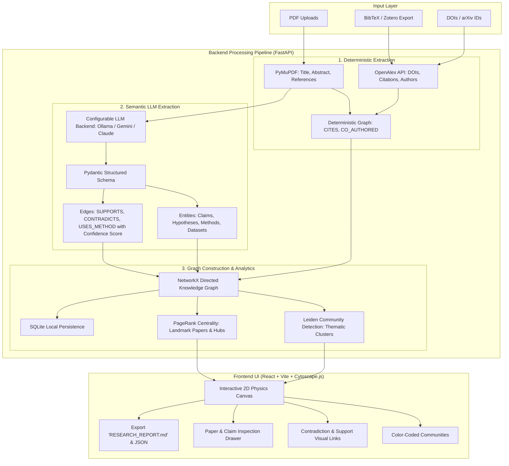

# Technical Blueprint: Research Graph Tool (`research-graph`)

**Version:** 1.0  
**Status:** Architecture Approved & Ready for Review  
**Inspired By:** [Graphify](https://github.com/Graphify-Labs/graphify) (`graphifyy`)  

---

## 1. System Vision & Architecture Overview

The **Research Graph Tool** adapts the core architectural pattern of **Graphify** (codebase AST + semantic LLM + community clustering + agent reports) into a specialized **Academic Research Knowledge Graph Web Platform**.

Instead of parsing source code via Tree-sitter, it parses **research papers (PDFs, BibTeX, DOIs)** deterministically, uses an LLM to extract **Claims, Methodologies, Datasets, and Contradictions**, clusters them into thematic schools of thought via the **Leiden algorithm**, and renders a dynamic, interactive canvas powered by **Cytoscape.js / Vis-Network** backed by a **FastAPI + SQLite + NetworkX** engine.



---

## 2. Graph Schema Specification

### 2.1 Node Types

| Node Type | Key Attributes | Description |
| :--- | :--- | :--- |
| **`Paper`** | `id`, `title`, `authors`, `year`, `doi`, `journal`, `abstract`, `cluster_id`, `pagerank_score`, `is_landmark` | Central scientific publication unit |
| **`Author`** | `id`, `name`, `affiliation`, `paper_count` | Researcher node |
| **`Claim`** | `id`, `text`, `confidence`, `polarity`, `paper_id` | Specific scientific assertion or empirical finding |
| **`Methodology`** | `id`, `name`, `type`, `description` | Algorithmic or experimental technique (e.g. "Transformer", "CRISPR", "Double-blind RCT") |
| **`Dataset`** | `id`, `name`, `benchmark_metric` | Empirical dataset or benchmark used for evaluation |

### 2.2 Edge Types & Confidence Model

Borrowing Graphify's confidence model, every edge has an provenance classification:
- `EXTRACTED`: Explicit bibliographic fact (100% precision, zero hallucination).
- `INFERRED`: Derived by LLM analysis, accompanied by a confidence score `[0.0 - 1.0]` and reasoning snippet.
- `AMBIGUOUS`: Unresolved cross-citation or conflicting evidence.

| Edge Type | Source Node | Target Node | Provenance | Description |
| :--- | :--- | :--- | :--- | :--- |
| **`CITES`** | `Paper` | `Paper` | `EXTRACTED` | Formal academic reference |
| **`CO_AUTHORS`** | `Author` | `Paper` | `EXTRACTED` | Authorship link |
| **`ASSERTS`** | `Paper` | `Claim` | `INFERRED` | Paper posits a specific finding |
| **`SUPPORTS`** | `Claim` / `Paper` | `Claim` | `INFERRED` | Corroborates or reproduces evidence |
| **`CONTRADICTS`** | `Claim` / `Paper` | `Claim` | `INFERRED` | Direct scientific contradiction, dispute, or conflicting results |
| **`EXTENDS`** | `Paper` | `Paper` | `INFERRED` | Directly builds upon earlier methodology or framework |
| **`USES_METHOD`** | `Paper` | `Methodology` | `INFERRED` | Leverages specific methodology |
| **`EVALUATES_ON`** | `Paper` | `Dataset` | `INFERRED` | Evaluated against standard benchmark |

---

## 3. Backend Architecture (FastAPI + Python)

### 3.1 Technology Stack
- **FastAPI**: Asynchronous REST API server with automatic OpenAPI documentation.
- **PyMuPDF (`fitz`)**: Blazing-fast PDF parsing and text/section hierarchy extraction.
- **OpenAlex Client / `requests`**: Resolves DOIs and fetches citation graphs from OpenAlex (250M+ open scientific works).
- **NetworkX**: In-memory graph modeling, shortest paths, centrality metrics, and clustering.
- **`cdlib` / `python-louvain`**: Community detection (Leiden / Louvain) to segment literature into thematic disciplines.
- **Pydantic & Instructor**: Structured output validation from LLMs.
- **SQLite (`aiosqlite`)**: Zero-setup embedded database for persistent paper metadata, parsed text, and claim records.

### 3.2 Directory Structure
```
research-graph-tool/
├── backend/
│   ├── app/
│   │   ├── main.py                  # FastAPI app entry point & routes
│   │   ├── config.py                # Environment & model configs (Ollama / Gemini / Claude)
│   │   ├── database.py              # SQLite connection & schema initialization
│   │   ├── models/                  # Pydantic data schemas
│   │   │   ├── graph.py             # Node & Edge definitions
│   │   │   └── extraction.py        # LLM structured output schema
│   │   ├── services/
│   │   │   ├── pdf_parser.py        # PyMuPDF section & bibliography parser
│   │   │   ├── academic_api.py      # OpenAlex & CrossRef citation resolution
│   │   │   ├── llm_extractor.py     # Pluggable LLM extraction (Ollama / Cloud)
│   │   │   ├── graph_engine.py      # NetworkX, Leiden clustering & PageRank
│   │   │   └── report_generator.py  # Markdown literature synthesis generator
│   │   └── uploads/                 # Local directory for uploaded PDF papers
│   └── requirements.txt
```

### 3.3 Core REST API Endpoints

1. `POST /api/papers/upload`
   - Upload one or multiple PDFs, or upload a `.bib` file.
   - Extracts metadata, sections, and references asynchronously.
2. `POST /api/papers/enrich-openalex`
   - Queries OpenAlex for DOIs, open-access citation trees, and co-author graphs.
3. `POST /api/papers/extract-claims`
   - Prompts the configured LLM backend (Ollama or Cloud) using structured schemas to extract claims, methods, and contradiction edges.
4. `GET /api/graph`
   - Returns the full graph formatted for Cytoscape.js (`{ nodes: [...], edges: [...] }`), complete with community IDs, node types, and edge weights.
5. `GET /api/report/markdown`
   - Generates and downloads `RESEARCH_REPORT.md` (literature summary, consensus, active debates, and identified research gaps).
6. `GET /api/graph/export-json`
   - Exports the raw machine-readable knowledge graph (`research_graph.json`).

---

## 4. Frontend Architecture (React + Vite + Cytoscape.js)

### 4.1 Technology Stack
- **React 19 + Vite**: Modern, responsive SPA.
- **Cytoscape.js + cytoscape-cola / cytoscape-fcose**: Force-directed physics layout with node clustering, smooth physics damping, and high rendering performance.
- **Lucide Icons**: Clean, academic-grade iconography.
- **Vanilla CSS / Custom Modern Design System**: Premium dark-mode aesthetic with glassmorphism, glowing node borders, and clean typography.

### 4.2 UI Component Layout

```
+-----------------------------------------------------------------------------------------+
| [ResearchGraph Logo]   [Upload Papers / BibTeX]   [Backend: Ollama / Gemini]   [Export] |
+-----------------------------------------------------------------------------------------+
| [FILTERS PANEL]         | [INTERACTIVE GRAPH CANVAS]               | [INSPECTION DRAWER] |
| - Thematic Clusters    |                                          | - Selected Paper    |
|   [x] NLP / LLM        |          (Paper Node: Attention)         |   * Authors, Year   |
|   [x] Graph Neural     |                     |                    |   * Abstract        |
| - Edge Types           |                   CITES                  | - Claims:           |
|   [x] Citations        |                     v                    |   * [SUPPORTS] ...  |
|   [x] Supports (Green) |        (Paper Node: BERT)                |   * [CONTRADICTS].. |
|   [x] Conflicts (Red)  |          /          \                    | - Methodology:      |
| - Landmark Papers Only |      SUPPORTS     CONTRADICTS            |   * Transformer     |
| - Search Bar           |        /              \                  | - BibTeX Entry      |
|                        |  (Claim Node A)   (Claim Node B)         |                     |
+-----------------------------------------------------------------------------------------+
| Bottom Stats Bar: 42 Papers | 184 Citations | 31 Claims | 4 Thematic Clusters           |
+-----------------------------------------------------------------------------------------+
```

---

## 5. Report & Agent Artifacts

Just like Graphify creates `graphify-out/GRAPH_REPORT.md` and `graph.json`, the Research Graph tool automatically generates:

1. **`RESEARCH_REPORT.md`**:
   - Executive Literature Synthesis
   - Identified Schools of Thought (detected clusters)
   - Foundational & Landmark Papers (highest PageRank)
   - Consensus vs. Conflicting Claims (active scientific debates)
   - Methodology Matrix (which methods were evaluated against which benchmarks)
   - Unexplored Research Gaps & Open Opportunities
2. **`research_graph.json`**:
   - Full serialization of nodes and edges, ready to be ingested by Claude Code, Gemini CLI, Cursor, or an MCP agent server.

---

## 6. Implementation Roadmap

- **Step 1: Backend Foundation (FastAPI & Database)**
  - Scaffold `backend/` directory, configure SQLite schema, and initialize FastAPI server.
- **Step 2: PDF Parsing & OpenAlex Resolution Engine**
  - Implement PyMuPDF text & reference extractor.
  - Implement OpenAlex API client for DOI citation backbone.
- **Step 3: Semantic LLM Claim & Contradiction Extractor**
  - Implement pluggable LLM provider (Ollama local / Cloud API) with Pydantic structured schemas.
- **Step 4: Graph Analytics Engine**
  - NetworkX integration with Leiden community clustering and PageRank centrality calculations.
- **Step 5: Frontend UI & Cytoscape Canvas**
  - Scaffold Vite React app, build drag-and-drop upload zone, dark-theme layout, and Cytoscape.js interactive graph with custom styling and node inspection drawer.
- **Step 6: Synthesis Report Generator & End-to-End Validation**
  - Generate instant `RESEARCH_REPORT.md` literature digest and test with sample research papers.
