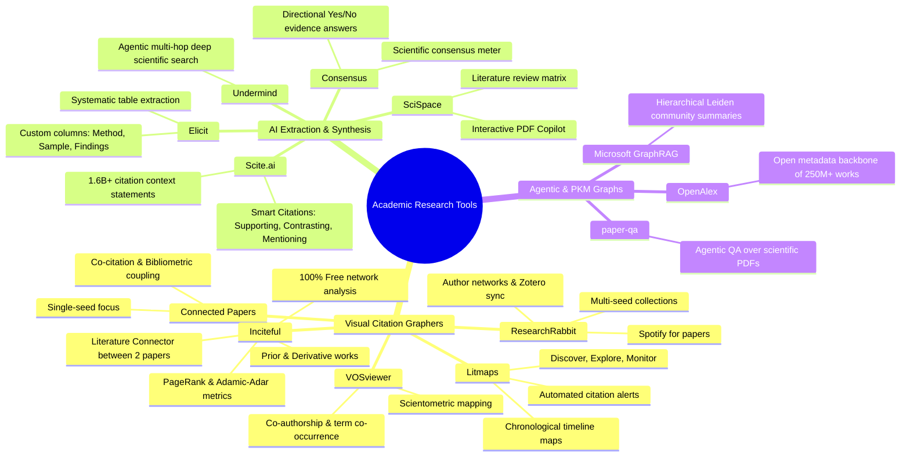

# Comprehensive Landscape Report: Academic Research Tools, Citation Graphers & AI Literature Assistants

**Date:** 2026-10-11  
**Depth:** Deep Comparative Market & Technical Analysis  
**Confidence overall:** High  

---

## 1. Executive Summary

- **Research Question:** What tools currently exist that create research and literature graphs, what broader research tools exist across the academic ecosystem, what specific functions and capabilities do they provide, and where are the critical functional gaps?
- **Core Findings:**
  - The academic discovery landscape is segmented into **four distinct generations of tools**:
    1. *Bibliometric Network Visualizers (Gen 1):* Desktop scientific mapping software (**VOSviewer**, **CitNetExplorer**) focused on co-citation and keyword co-occurrence for scientometricians.
    2. *Visual Citation & Discovery Platforms (Gen 2):* Web-based citation graphs (**Connected Papers**, **ResearchRabbit**, **Litmaps**, **Inciteful**) that map bibliographic coupling, co-citation clusters, and chronological timelines from a single or multiple seed papers.
    3. *AI Evidence Extraction & Claim Verifiers (Gen 3):* LLM-driven engines that parse full text for claims, consensus, and methodology tables (**Scite.ai**, **Elicit**, **Consensus**, **SciSpace**, **Undermind**). Notably, **Scite.ai** pioneered "Smart Citations" (classifying citations into *Supporting*, *Contrasting*, or *Mentioning*).
    4. *Agentic Graph RAG & Personal Knowledge Networks (Gen 4):* Emerging frameworks (**Microsoft GraphRAG**, **Future-House paper-qa**, **Obsidian / Heptabase**) that merge graph retrieval with LLM reasoning.
  - **The Critical Market Gap:** **No single tool bridges Gen 2 (visual citation graphs) with Gen 3 (claim/contradiction extraction) in a local, developer- or agent-accessible format.** 
    - Existing visual tools (Connected Papers, Litmaps) only show *who cites whom*, not *what is claimed or contradicted*.
    - Existing AI tools (Elicit, Consensus, Scite) extract claims and consensus into *flat tables or lists*, lacking an interactive topological graph.
    - Virtually all modern tools are closed, proprietary SaaS web apps with usage paywalls; none provide an open CLI, standalone exportable HTML canvas, or Model Context Protocol (MCP) server for local AI coding assistants (like Graphify does for code).
- **Feasibility & Opportunity for Our Tool (`research-graph`):** **Exceptional Opportunity**. By combining the visual graph mechanics of Inciteful/Litmaps with the claim contradiction model of Scite.ai and Graphify's local-first agent report architecture (`RESEARCH_REPORT.md` + MCP), our proposed tool fills a clear void.
- **Top 3 Strategic Next Steps:**
  1. Incorporate **Scite.ai-style Smart Citation extraction** (`SUPPORTS`, `CONTRADICTS`, `MENTIONS`) into our LLM extraction schema.
  2. Implement **Inciteful's "Literature Connector" algorithm** (shortest citation path bridging two disparate topics).
  3. Adopt **Litmaps' timeline visualization toggle** alongside the 2D force-directed physics layout.

---

## 2. Scope, Assumptions & Method

- **Scope:** In-depth evaluation of 15+ academic research tools spanning citation network visualizers, AI literature review platforms, citation intelligence engines, and academic knowledge graph frameworks.
- **Tools Evaluated:**
  - *Graph Discovery:* Connected Papers, ResearchRabbit, Litmaps, Inciteful, VOSviewer, CitNetExplorer.
  - *AI Extraction & Synthesis:* Scite.ai, Elicit, Consensus, SciSpace (Typeset), Undermind, Semantic Scholar.
  - *Agentic & Knowledge Management:* Microsoft GraphRAG, Future-House paper-qa, Obsidian (Canvas/Juggl), OpenAlex.
- **Evaluation Criteria:** Graph algorithm & topology, data extraction depth, citation classification (supporting/contrasting), export formats, AI agent accessibility, licensing, and pricing model.

---

## 3. Comprehensive Breakdown of Existing Tools & Functions

---

### 3.1 Category A: Visual Citation & Literature Graph Tools

#### 1. Connected Papers ([connectedpapers.com](https://www.connectedpapers.com))
- **Primary Mechanic:** Builds a 2D force-directed graph around a **single seed paper** using **co-citation** (papers frequently cited together by others) and **bibliographic coupling** (papers sharing common references).
- **Core Functions:**
  - *Visual Neighborhood:* Clusters papers by semantic & bibliographic similarity, even if they don't directly cite each other.
  - *Prior Works:* Identifies the seminal, foundational papers that the entire cluster cites most frequently.
  - *Derivative Works:* Identifies recent major papers that cite many papers in the cluster.
  - *Graph Attributes:* Node size reflects citation count; node color reflects publication year.
- **Limitations:** Strictly optimized for a single seed paper; cannot build combined multi-seed graphs; restrictive free tier (5 free graphs/month).

#### 2. ResearchRabbit ([researchrabbitapp.com](https://www.researchrabbitapp.com))
- **Primary Mechanic:** Known as the "Spotify for Papers". Emphasizes **persistent, multi-seed collections** that learn user interests.
- **Core Functions:**
  - *Multi-Seed Ingestion:* Add dozens of papers into a collection; generates recommendations based on the whole set.
  - *Author Networks:* Visualizes author collaboration graphs and tracks leading researchers in a field.
  - *Bi-Directional Zotero Sync:* Pulls collections from Zotero and pushes newly discovered papers back.
  - *Continuous Alerts:* Sends periodic email digests when new related papers appear.
- **Limitations:** Graph visualization is secondary to collection management; can feel busy and unintuitive on large libraries.

#### 3. Litmaps ([litmaps.com](https://www.litmaps.com))
- **Primary Mechanic:** Combines citation discovery with a **chronological timeline axis**.
- **Core Functions:**
  - *Explore (Map View):* Plots papers with the X-axis as publication year and Y-axis as citation count or relevance, showing the chronological lineage of ideas.
  - *Discover:* Expands existing maps by suggesting top citing and referenced articles.
  - *Monitor:* Proactive background monitoring that emails researchers when new papers cite any paper in their map.
  - *Multi-Map Sharing:* Exportable, interactive maps shareable with lab collaborators.
- **Limitations:** Freemium tier limits the number of monitored maps and nodes per map.

#### 4. Inciteful ([inciteful.xyz](https://inciteful.xyz))
- **Primary Mechanic:** 100% free, open web tool using deep network science algorithms on open academic data.
- **Core Functions:**
  - *Paper Discovery:* Multi-seed graph engine computing PageRank, Adamic-Adar similarity, and bibliographic coupling to surface foundational literature.
  - *Literature Connector:* **Unique feature:** Allows inputting two distinct papers and computes the shortest citation path and bridge papers connecting them (ideal for interdisciplinary research).
  - *BibTeX / RIS Ingestion:* Import directly from reference managers without account lock-in.
- **Limitations:** UI is functional and utilitarian rather than consumer-polished; lacks AI-driven claim extraction.

#### 5. VOSviewer ([vosviewer.com](https://www.vosviewer.com))
- **Primary Mechanic:** Desktop Java software built by CWTS Leiden for bibliometric and scientometric network mapping.
- **Core Functions:**
  - *Bibliometric Network Construction:* Maps co-authorship networks, keyword co-occurrences, and journal citation patterns.
  - *Density Visualization:* Heatmap views showing high-density scientific activity clusters.
  - *Broad Compatibility:* Ingests data exports from Web of Science, Scopus, PubMed, Dimensions, and OpenAlex.
- **Limitations:** Heavy desktop app; static snapshot analysis; zero semantic natural language or LLM synthesis capabilities.

---

### 3.2 Category B: AI Extraction, Evidence & Synthesis Tools

#### 1. Scite.ai ([scite.ai](https://www.scite.ai)) — *The Gold Standard for Citation Classification*
- **Primary Mechanic:** Deep learning model trained on full text of 1.6+ billion citation statements to classify citation intent.
- **Core Functions:**
  - *Smart Citations:* Categorizes every citation into three explicit buckets:
    - **Supporting:** Citing paper replicates or provides corroborating empirical evidence.
    - **Contrasting:** Citing paper disputes, fails to replicate, or contradicts the findings.
    - **Mentioning:** Citing paper provides general background context.
  - *Citation Context Excerpts:* Shows the exact 3-sentence snippet (sentence before, sentence containing, sentence after) where the citation occurred.
  - *Scite Assistant:* Natural-language Q&A grounded exclusively in verified Smart Citations.
- **Value to Our Project:** Scite proves that **contradiction vs. support classification** is the single highest-value feature researchers want when assessing scientific validity.

#### 2. Elicit ([elicit.com](https://elicit.com)) — *The Systematic Extraction Engine*
- **Primary Mechanic:** Automates literature screening and structured data extraction across thousands of papers.
- **Core Functions:**
  - *Custom Column Extraction:* Extracts exact methodology, participant sample size, intervention, effect size, and limitations into a spreadsheet matrix.
  - *Synthesis Paragraphs:* Synthesizes the top 8 papers into a cohesive paragraph answering a specific research question.
  - *PDF Upload Ingestion:* Upload private papers to run the extraction matrix locally.
- **Limitations:** Outputs are strictly tabular (tables and summaries); has **no graph visualization** whatsoever.

#### 3. Consensus ([consensus.app](https://consensus.app)) — *The Evidence Search Engine*
- **Primary Mechanic:** AI search engine that reads peer-reviewed literature to answer directional scientific questions.
- **Core Functions:**
  - *Consensus Meter:* Evaluates whether the scientific community says "Yes", "No", or "Possibly" to a question (e.g., "Does creatine improve cognitive memory?").
  - *Study Details Badge:* Tags papers with study type (Systematic Review, RCT, Animal Study) and sample size.
  - *Synthesized Answers:* Generates evidence-backed answers with inline paper citations.
- **Limitations:** Broad and consumer-oriented; limited deep graph traversal or multi-paper lineage tracking.

#### 4. SciSpace / Typeset ([scispace.com](https://scispace.com)) — *All-in-One Research Workspace*
- **Primary Mechanic:** Complete end-to-end workspace integrating literature search, PDF reading, and manuscript writing.
- **Core Functions:**
  - *Interactive Copilot:* Highlight any text, formula, or table in an academic PDF and ask the AI to explain it in simple terms.
  - *Literature Review Matrix:* Side-by-side comparison of papers across research questions and conclusions.
  - *Citation Generator & Paraphraser:* Embedded writing tools.
- **Limitations:** Highly generalized SaaS platform; graph visualization is not a focus.

#### 5. Undermind ([undermind.ai](https://www.undermind.ai)) — *Autonomous Agentic Search*
- **Primary Mechanic:** Uses an autonomous LLM reasoning loop that runs dozens of recursive searches across academic databases, reading full texts to answer nuanced, complex queries.
- **Core Functions:**
  - Discovers obscure papers that keyword searches miss by evaluating relevance like a human PhD researcher.
  - Generates comprehensive, deep research reports citing 50+ papers.

---

### 3.3 Category C: Personal Knowledge Graphs & Agentic Graph RAG

#### 1. Microsoft GraphRAG ([github.com/microsoft/graphrag](https://github.com/microsoft/graphrag))
- **Mechanic:** Uses LLMs to extract entities and relationships from raw text, builds a knowledge graph, clusters nodes hierarchically with the **Leiden algorithm**, and generates pre-computed summaries for each community.
- **Relevance:** Graphify and GraphRAG use the same community detection philosophy (Leiden). When applied to research papers, this enables high-level answering of broad questions ("What are the prevailing methodologies in this entire subfield?").

#### 2. Future-House paper-qa ([github.com/Future-House/paper-qa](https://github.com/Future-House/paper-qa))
- **Mechanic:** Agentic RAG library engineered specifically for scientific papers. Embeds text with metadata, extracts quotes, scores relevance, and generates answers strictly constrained to cited evidence.

#### 3. Obsidian (with Canvas & Juggl Plugins)
- **Mechanic:** Local Markdown personal knowledge management (PKM) tool with bi-directional wikilinks. Researchers use community plugins like **Obsidian Citations** (Zotero sync) and **Juggl / Obsidian Canvas** to manually draw conceptual knowledge graphs between paper notes.

---

## 4. Master Feature Comparison Matrix

| Feature / Capability | Connected Papers | ResearchRabbit | Litmaps | Inciteful | Scite.ai | Elicit | Proposed Tool (`research-graph`) |
| :--- | :---: | :---: | :---: | :---: | :---: | :---: | :---: |
| **Interactive Graph Canvas** | Yes (2D) | Yes (2D) | Yes (2D/Timeline) | Yes (2D) | No | No | **Yes (Cytoscape 2D Force)** |
| **Multi-Seed Ingestion** | No (Single) | Yes | Yes | Yes | Yes | Yes | **Yes (PDF Folder + BibTeX)** |
| **Local / Private PDF Upload** | No | No | No | No | No | Yes | **Yes (Local-first PyMuPDF)** |
| **Citation Network (Who cites whom)** | Yes | Yes | Yes | Yes | Yes | Yes | **Yes (OpenAlex Backbone)** |
| **Contradiction / Support Detection** | No | No | No | No | **Yes (Smart Citations)** | Minimal | **Yes (LLM Claim Graph)** |
| **Methodology & Dataset Nodes** | No | No | No | No | No | In Table | **Yes (Explicit Graph Nodes)** |
| **Thematic Community Clustering** | Visual | Collections | No | NetworkX | No | No | **Yes (Leiden Algorithm)** |
| **Interdisciplinary "Bridge" Search** | No | No | No | **Yes (Connector)** | No | No | **Yes (Shortest Path Bridge)** |
| **Literature Synthesis Report** | No | No | No | No | Chat only | Summary text | **Yes (`RESEARCH_REPORT.md`)** |
| **AI Agent Queryable (MCP Server)** | No | No | No | No | No | No | **Yes (FastMCP Integration)** |
| **Pricing Model** | Freemium | Free | Freemium | 100% Free | Subscription | Freemium | **100% Open Source / Free** |
| **Data Privacy** | Cloud SaaS | Cloud SaaS | Cloud SaaS | Cloud SaaS | Cloud SaaS | Cloud SaaS | **Local SQLite / Ollama Support** |

---

## 5. Critical Functional Gaps in the Market

Through this research, five distinct gaps emerge that existing tools fail to solve:

1. **The "Graph vs. Table" Dichotomy:**
   - Tools that have graphs (Connected Papers, Litmaps) only show *bibliometric metadata* (who cites whom, publication years, author names). They do not understand the scientific content inside the papers.
   - Tools that understand scientific content (Elicit, Scite, Consensus) display their output in *tables, lists, or chat boxes*. They lack a spatial graph that lets you see how concepts, methods, and claims connect across an entire domain.
2. **The "Closed Cloud" Lock-in:**
   - Every modern visual research tool is a hosted cloud application. Researchers working on unpublished manuscripts, proprietary industrial R&D, or sensitive medical trials cannot upload their confidential PDFs to Connected Papers or Elicit without violating data privacy policies.
3. **Absence of AI Agent Tooling (No MCP / CLI):**
   - As researchers adopt AI coding and reasoning agents (Claude Code, Cursor, Gemini CLI, Antigravity), there is no tool that can generate a machine-readable literature graph (`research_graph.json`) or expose an MCP server so an agent can autonomously navigate a 200-paper library.
4. **Lack of Automated Literature Synthesis Artifacts:**
   - No tool produces a comprehensive, standalone markdown document equivalent to Graphify's `GRAPH_REPORT.md` that synthesizes the entire research corpus (foundational papers, methodology matrix, consensus, active debates, and unexplored research gaps) in a format ready to be consumed in one prompt by an LLM.

---

## 6. Strategic Recommendations for Our Project (`research-graph`)

To make our tool uniquely compelling, we should combine the best specialized mechanics from the top tools:

1. **Borrow from Scite.ai:**
   - Implement the `SUPPORTS`, `CONTRADICTS`, and `MENTIONS` edge classification with quotation evidence snippets.
2. **Borrow from Inciteful:**
   - Implement the **"Literature Connector"** algorithm: give researchers a button to select any two papers in their graph and calculate the shortest bridging path of citations or shared methodologies.
3. **Borrow from Litmaps:**
   - Include a toggle in the UI between the **Force-Directed Physics Layout** (semantic clustering) and a **Timeline Layout** (X-axis = Year, Y-axis = Impact).
4. **Borrow from Graphify:**
   - Preserve the local-first CLI and automatic generation of `RESEARCH_REPORT.md` and `research_graph.json`.
   - Maintain the **Leiden community detection** to automatically identify distinct "Schools of Thought" in the literature.

---

## 7. Sources

1. [Connected Papers Technical Overview & Methodology](https://www.connectedpapers.com)
2. [ResearchRabbit Platform & Collection Architecture](https://www.researchrabbitapp.com)
3. [Litmaps Features: Discover, Explore, and Monitor](https://www.litmaps.com)
4. [Inciteful Paper Discovery and Literature Connector Documentation](https://inciteful.xyz)
5. [Scite.ai Smart Citations & Classification Model](https://scite.ai)
6. [Elicit Systematic Literature Review Platform](https://elicit.com)
7. [Consensus Evidence Search Engine & Consensus Meter](https://consensus.app)
8. [SciSpace Research Workspace & PDF Copilot](https://scispace.com)
9. [Undermind Autonomous Deep Literature Search](https://www.undermind.ai)
10. [CWTS VOSviewer Manual & Bibliometric Techniques](https://www.vosviewer.com)
11. [Microsoft GraphRAG: From Local to Global Graph Retrieval](https://github.com/microsoft/graphrag)
12. [Future-House paper-qa: Scientific RAG Framework](https://github.com/Future-House/paper-qa)
13. [OpenAlex Documentation & Data Schema](https://openalex.org)
