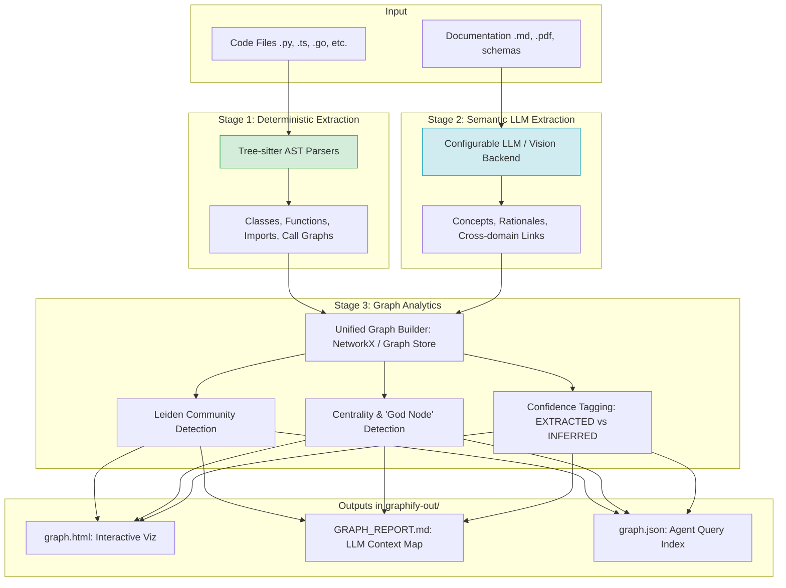
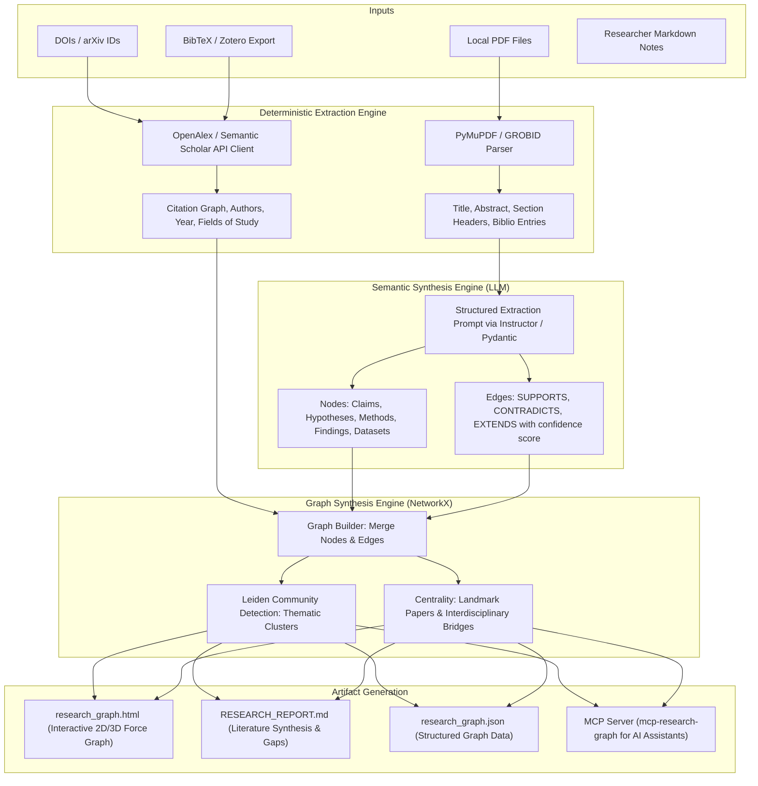

# Feasibility & Architectural Report: Building a "Research Graph" Tool Inspired by Graphify

**Date:** 2026-10-11  
**Depth:** Deep Technical Deep-Dive & Architecture Blueprint  
**Confidence overall:** High  

---

## 1. Executive Summary

- **Research Question:** How does [Graphify](https://github.com/Graphify-Labs/graphify) (`graphifyy`) work under the hood, and how can its architectural principles (deterministic extraction, semantic LLM enrichment, Leiden community clustering, and agent-ready graph reports) be repurposed into a specialized **Research Knowledge Graph** tool for academic researchers and AI agents?
- **Core Findings:**
  - Graphify solves the "LLM context window and token waste" problem for codebases by parsing code deterministically via **Tree-sitter ASTs**, extracting semantic concepts via LLMs, clustering nodes with the **Leiden algorithm**, and outputting three core artifacts: `graph.html` (interactive visualization), `GRAPH_REPORT.md` (compact architectural digest for LLM context), and `graph.json` (agent-queryable graph).
  - Translating this to academic research is **not only possible, but uniquely high-leverage**: researchers face identical context constraints when trying to feed 50–200 scientific PDFs into an LLM.
  - In a **Research Graph Tool**, the Tree-sitter deterministic AST is replaced by **Academic PDF & Metadata Extractors** (DOI / CrossRef / OpenAlex / Semantic Scholar citation graphs), while the LLM semantic layer extracts **Claims, Hypotheses, Methodologies, Datasets, Contradictions, and Research Gaps**.
- **Feasibility Verdict:** **Feasible with Caveats**.
  - *Verdict Reason:* The foundational libraries in Python (`networkx`, `openalex-api`, `pymupdf`/`grobid`, `pydantic`, `cdlib`/`leidenalg`, and `fastmcp`) make end-to-end building straightforward for a solo developer or small team. The primary caveats are PDF parsing heterogeneity (tables/multi-column figures) and LLM extraction latency/cost for large paper corpuses (mitigated by batching and schema-constrained local or cloud models).
- **Top 3 Risks:**
  1. *PDF Ingestion Noise:* Unstructured academic PDFs have inconsistent layouts, broken reference anchors, and OCR quirks.
  2. *Hallucinated Relationships in Literature Synthesis:* Over-reliance on LLM inference without deterministic citation anchoring (`EXTRACTED` vs `INFERRED`).
  3. *Academic API Rate Limits:* Commercial or high-volume indexing against Semantic Scholar or CrossRef requires API keys or polite rate limiting.
- **Top 3 Recommended Next Steps:**
  1. Define the core Research Graph Schema (Nodes: `Paper`, `Author`, `Claim`, `Methodology`, `Dataset`; Edges: `CITES`, `SUPPORTS`, `CONTRADICTS`, `USES_METHOD`).
  2. Implement Phase 1: Local PDF Ingestion (`pymupdf` + `pydantic`) combined with OpenAlex / Semantic Scholar API lookup to build the deterministic citation backbone.
  3. Generate Graphify-equivalent outputs: `research_graph.html` (Cytoscape/Vis.js), `RESEARCH_REPORT.md` (instant LLM literature synthesis), and an MCP server for chat-agent traversal.

---

## 2. Scope, Assumptions & Method

- **Scope:** Technical deconstruction of Graphify (`graphifyy`), comparative analysis with existing academic graph tools (Connected Papers, ResearchRabbit, Elicit, SciSpace), system architecture for a novel Research Graph tool, API & library evaluations, and execution plan.
- **Assumptions:**
  - The target user is an academic researcher, PhD candidate, R&D engineer, or an autonomous research agent (e.g., Claude Code, Cursor, Gemini CLI, Antigravity).
  - The tool should run locally as a CLI and AI Agent Skill / MCP Server, supporting local or cloud LLM backends (Ollama, Claude, OpenAI, Gemini).
  - Open-source, permissive licensing (MIT / Apache 2.0) is desired.
- **Method & Sources Reviewed:**
  - Public source analysis, documentation, and technical breakdowns of Graphify (`graphifyy`, Graphify Labs).
  - Comparative analysis of academic metadata APIs (OpenAlex, Semantic Scholar Academic Graph / S2AG, Crossref, arXiv).
  - Evaluation of network analysis, community detection, and interactive graph rendering engines.

---

## 3. Findings

### 3.1 Overview of Graphify (`Graphify-Labs/graphify`)

Graphify is an open-source command-line tool and AI agent skill (installed via `uv tool install graphifyy` or `pip install graphifyy`) designed to map codebases into queryable, multimodal knowledge graphs.

#### The Problem Graphify Solves:
When AI coding assistants (Claude Code, Cursor, Codex, Gemini) work on large repositories:
1. Grepping / keyword searching lacks semantic relationships and architectural awareness.
2. Vector embeddings (standard RAG) retrieve isolated chunks without call chains or dependency context.
3. Ingesting full codebases exhausts context windows, balloons token costs, and degrades model reasoning over large contexts.

#### How Graphify Solves It:
Graphify runs a command (e.g. `/graphify .`) that parses the project into a structured graph, clusters it into functional communities, and produces human- and agent-readable artifacts in `graphify-out/`:
- `graph.html`: Standalone, interactive browser-based visualization.
- `GRAPH_REPORT.md`: Condensed architectural synthesis highlighting "God Nodes" (central components), dependency flows, and key entry points.
- `graph.json`: Machine-readable graph structure queryable directly by LLM agents without reading raw code files.

---

### 3.2 Graphify Architecture & Pipeline

Graphify operates on a two-tier extraction pipeline:

#### Key Technical Mechanics:
1. **Zero-Leak Deterministic AST:** Code is parsed locally using Tree-sitter grammars (36+ languages). Functions, classes, and calls are resolved with 100% precision with zero token cost.
2. **Confidence Tagging:**
   - `EXTRACTED`: Explicit AST relationships (e.g. `FileA imports FileB`, `ClassX calls methodY`).
   - `INFERRED`: Probabilistic relationships generated by an LLM with confidence values (0.0–1.0).
   - `AMBIGUOUS`: Flagged when references are unresolved.
3. **Leiden Community Detection:** Partitions hundreds of nodes into natural subsystems (e.g., Auth, Database ORM, UI Components) without requiring vector search.
4. **Centrality Metrics (God Nodes):** Uses degree and PageRank centrality to highlight critical bottlenecks and core abstractions.

---

### 3.3 The Paradigm Shift: Adapting Graphify to a Research Tool

In research, the challenge is identical to codebase navigation: **a researcher or LLM cannot read 100 20-page scientific PDFs simultaneously**. 

Here is how each component of Graphify maps to a **Research Graph Tool**:

| Graphify (Code Graph) | Proposed Research Graph Tool (`research-graph`) | Implementation Technology |
| :--- | :--- | :--- |
| **Input Source** | Source code files, config, SQL | Research PDFs, BibTeX, DOIs, arXiv URLs, Markdown research notes |
| **Stage 1: Deterministic Ingestion** | Tree-sitter AST (imports, calls, inheritance) | **PDF Parsers + Academic Graph APIs** (OpenAlex, CrossRef, Semantic Scholar) |
| **Deterministic Edges** | `imports`, `calls`, `inherits`, `defines` | `CITES`, `CO_AUTHORS`, `PUBLISHED_IN`, `REFERENCES_DATASET` |
| **Stage 2: Semantic LLM Ingestion** | Docstrings, Markdown specs, system intent | **Structured Claim & Finding Extraction** (Claims, Hypotheses, Methods, Limitations) |
| **Semantic Edges** | `implements_spec`, `configures` | `SUPPORTS`, `CONTRADICTS` / `REFUTES`, `EXTENDS`, `USES_METHODOLOGY` |
| **Confidence Scoring** | `EXTRACTED` vs `INFERRED` | `EXTRACTED` (literal citation/DOI) vs `INFERRED` (LLM-detected claim alignment or contradiction) |
| **Clustering Algorithm** | Leiden algorithm (code modules) | **Leiden / Louvain algorithm** (Thematic research schools, subfields, methodological paradigms) |
| **Centrality Analysis** | "God Nodes" (core classes/modules) | **"Foundational / Landmark Papers"** (High PageRank) & **"Bridge Papers"** (Betweenness centrality) |
| **Visual Output** | `graph.html` (code architecture) | `research_graph.html` (interactive literature landscape, color-coded by cluster/claim) |
| **Context Report** | `GRAPH_REPORT.md` | `RESEARCH_REPORT.md` (structured synthesis of consensus, debates, methodology matrix, and gaps) |
| **Agent / MCP Tool** | `graph.json` + CLI commands | `research_graph.json` + `mcp-research-graph` server for Claude / Gemini / Cursor |

---

### 3.4 Research Tool System Architecture

---

### 3.5 Academic APIs & Technical Components

To build this tool robustly without high costs, we evaluate the optimal technical stack:

#### 1. PDF Parsing & Metadata Extraction
- **PyMuPDF (`fitz`)**: Fast, lightweight local Python library. Extracts text, font hierarchies (detecting titles and section headings), and reference sections.
- **GROBID (Optional high-accuracy engine)**: State-of-the-art machine-learning parser for scientific documents that breaks down full papers into TEI-XML (authors, affiliations, abstracts, citations). Can run via local Docker container.
- **`bibtexparser` / `pybtex`**: For ingesting researcher Zotero/Mendeley libraries.

#### 2. Deterministic Academic Metadata APIs
- **OpenAlex API (Recommended)**: Completely open, non-profit, cataloging 250M+ scientific works. Provides citation graphs, concept tags, Open Access links, and author networks. Free up to 100k requests/day with simple polite email header.
- **Semantic Scholar API (S2AG)**: Excellent citation intents (`background`, `methodology`, `result`). Free tier available with rate limits.
- **CrossRef API & arXiv API**: Reliable DOI metadata lookup and pre-print abstracts.

#### 3. Graph Data Structure & Algorithms
- **NetworkX**: Standard Python graph library; serializes easily to JSON, GraphML, and Cytoscape formats.
- **`cdlib` / `python-louvain` / `leidenalg`**: Implements Louvain and Leiden community detection for clustering literature into sub-disciplines.

#### 4. Visualization
- **Vis.js / Cytoscape.js / 3d-force-graph**: Embedded directly in a standalone, zero-dependency `research_graph.html`. Allows clicking nodes to view paper summaries, filtering by claim (`Supports` in green, `Contradicts` in red), and zooming into thematic clusters.

#### 5. AI Agent Integration (MCP)
- **Model Context Protocol (FastMCP)**: Exposes tools directly to AI coding assistants:
  - `query_literature(claim="...")`
  - `find_contradictions(paper_id="...")`
  - `trace_method_lineage(method="transformer")`
  - `identify_research_gaps()`

---

### 3.6 Competitive Landscape & Differentiation

| Tool | Focus | Graph Type | Local/Privacy | LLM Synthesis Report | AI Agent (MCP) Queryable |
| :--- | :--- | :--- | :--- | :--- | :--- |
| **Connected Papers** | Visual citation graph | Co-citation / Bibliographic coupling | Web app (Cloud) | No | No |
| **ResearchRabbit** | Interactive citation discovery | Author / Paper citation trees | Web app (Cloud) | No | No |
| **Elicit / SciSpace** | Literature review search | Table of extracted claims | Web app (Cloud) | Summaries only | No |
| **Graphify** | Codebase navigation | AST + LLM code graph | Local CLI | Yes (`GRAPH_REPORT.md`) | Yes |
| **Our Proposed Tool (`research-graph`)** | **Academic Literature & Synthesis** | **Multimodal Citation + Claim + Contradiction Graph** | **Local CLI + API** | **Yes (`RESEARCH_REPORT.md`)** | **Yes (`mcp-research-graph`)** |

**Unique Advantage:** Existing academic tools are walled-garden web dashboards. None provide a local-first CLI that outputs a single-load LLM context map (`RESEARCH_REPORT.md`) and an MCP server that turns Claude or Gemini into an autonomous research assistant over a private paper corpus.

---

## 4. Feasibility Analysis

**Verdict:** **Feasible with Caveats**

| Dimension | Rating | Analysis & Justification |
| :--- | :--- | :--- |
| **Technical Feasibility** | **High** | All core building blocks exist as mature open-source Python packages (`networkx`, `pymupdf`, `fastmcp`, `pydantic`). |
| **Data & Access** | **High** | OpenAlex and CrossRef APIs provide open, free citation graphs. Local PDFs provide offline content. |
| **Legal & Policy** | **High** | Research paper abstracts and metadata are open data. Processing user-supplied PDFs locally complies fully with fair use and copyright. |
| **Cost** | **Low to Medium** | Deterministic processing is $0. Semantic claim extraction with an LLM can use local models (Ollama / Llama-3.3) for $0, or low-cost cloud models (Gemini Flash / Claude Haiku) costing ~$0.01 per paper. |
| **Effort & Skills** | **Medium** | A functional MVP can be built in ~1 to 2 weeks by a single developer; a fully polished CLI + MCP server in 3 to 4 weeks. |
| **Scalability & Maintenance** | **Medium** | In-memory graphs easily handle up to 5,000 papers. Scaling to 100k+ papers would require DuckDB or SQLite-backed graph storage. |
| **Risk & Dependencies** | **Low** | No single proprietary dependency; can swap LLM backends and citation APIs seamlessly. |

---

## 5. Recommendations & Implementation Plan

### 5.1 MVP Scope (Phase 1)
1. **CLI Ingestion:** `research-graph build ./papers/`
2. **Metadata & Citation Extractor:** Reads PDFs, queries OpenAlex API for DOIs/citations.
3. **Claim & Finding Extractor:** Prompts an LLM with title + abstract + conclusion to return structured JSON claims (`pydantic`).
4. **Graph Construction:** Builds a NetworkX graph with `EXTRACTED` (citation) and `INFERRED` (claim overlap) edges. Runs Leiden clustering.
5. **Outputs:**
   - `research-out/research_graph.html`: Interactive Vis.js visualization.
   - `research-out/RESEARCH_REPORT.md`: Instant literature review digest.
   - `research-out/research_graph.json`: Machine-readable graph.

### 5.2 Phased Roadmap
- **Phase 1 (MVP - 10 Days):** Local PDF ingestion + OpenAlex integration + NetworkX graph + `RESEARCH_REPORT.md` + standalone `research_graph.html`.
- **Phase 2 (Semantic Depth - 1 Week):** Contradiction detection (`SUPPORTS` vs `CONTRADICTS`), methodology taxonomy, confidence scoring.
- **Phase 3 (Agent Integration - 1 Week):** MCP Server exposing research traversal tools to Claude Code, Cursor, Gemini CLI, and Antigravity.
- **Phase 4 (Workflow Integration - Ongoing):** Zotero plugin / BibTeX watcher for auto-updating graphs upon adding papers.

---

## 6. Risks & Open Questions

| Risk / Unknown | Impact | Likelihood | Mitigation |
| :--- | :--- | :--- | :--- |
| **PDF parsing errors on complex layouts** | Medium | High | Fallback to OpenAlex / CrossRef / arXiv abstract metadata when local text extraction is noisy. |
| **LLM hallucinating false contradictions** | High | Medium | Strict few-shot prompt with quote requirements; mark edges as `INFERRED` with confidence score. |
| **Large literature collections (>500 papers)** | Medium | Low | Process papers concurrently with rate-limiting; cache paper embeddings and extracted claims locally in SQLite. |

---

## 7. Sources

1. [Graphify Official Repo & Docs](https://github.com/Graphify-Labs/graphify) — *Graphify-Labs: Knowledge graph generator for AI coding assistants.*
2. [Graphify Package Index (`graphifyy`)](https://pypi.org/project/graphifyy/) — *PyPI release and installation guide for Graphify.*
3. [OpenAlex Documentation & API](https://openalex.org/) — *Open, cataloged citation and entity graph for 250M+ scientific publications.*
4. [Semantic Scholar Academic Graph API](https://www.semanticscholar.org/product/api) — *Free, AI-powered academic paper metadata and citation intent API.*
5. [NetworkX Python Library](https://networkx.org/) — *Standard library for the creation, manipulation, and study of the structure of complex networks.*
6. [PyMuPDF Documentation](https://pymupdf.readthedocs.io/) — *High performance PDF parsing and text extraction.*
7. [The Leiden Algorithm (Traag et al.)](https://www.nature.com/articles/s41598-019-41695-x) — *From Louvain to Leiden: guaranteeing well-connected communities.*
